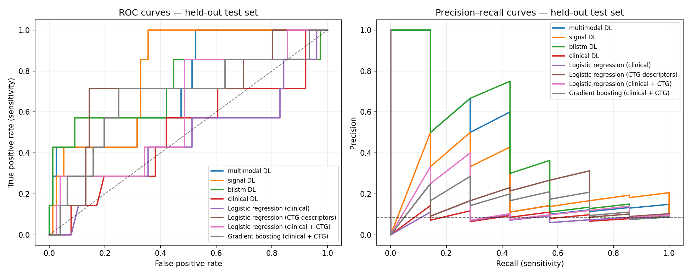
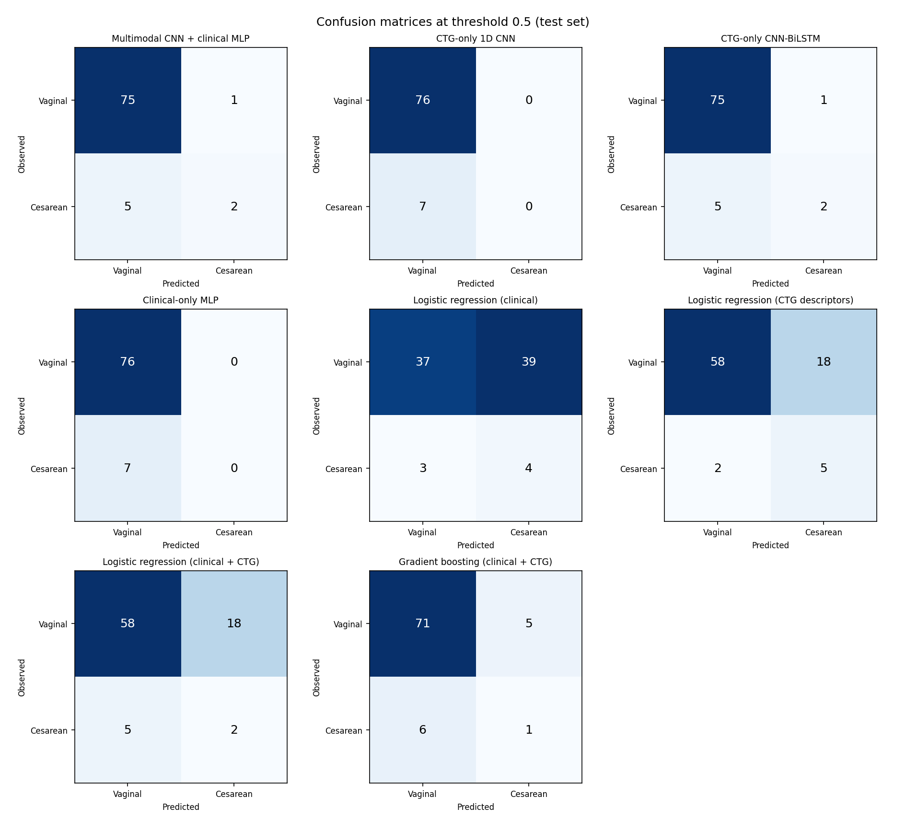
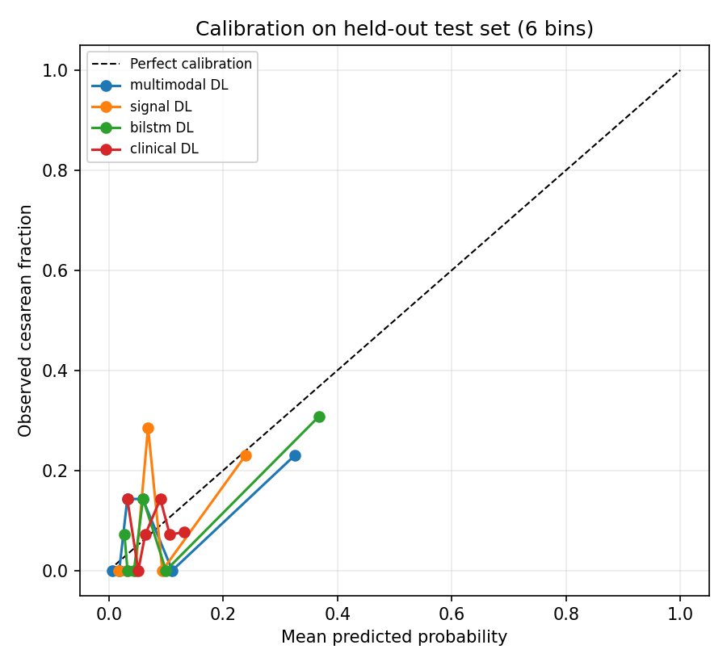
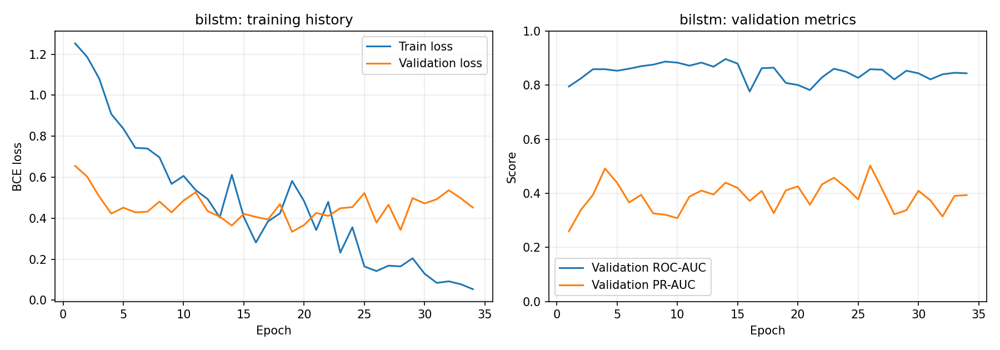
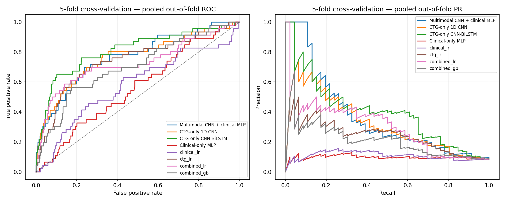

# Technical Report

**Project:** AI-Based Mobile Clinical Decision Support System for Delivery Outcome Prediction Using Cardiotocography and Maternal Clinical Data  
**System name:** OB-SIGHT (research prototype)  
**Version:** 1.1.0  
**Date:** 6 November 2026  
**Author:** Student project (academic submission)

> **Safety statement.** This is a research prototype. It is not a medical device, has not been prospectively or externally validated, and must not be used for clinical decisions, triage, counselling, or mode-of-delivery planning. The output is a statistical score from a small public dataset, not a diagnosis or a substitute for obstetric judgement.

---

## 1. Objective and scope

The project asks whether intrapartum cardiotocography (CTG) combined with maternal clinical data contains information about the **eventual mode of delivery** (cesarean versus vaginal). The deliverable is a complete, reproducible pipeline:

1. inspection and parsing of the public CTU-CHB database;
2. leakage-aware preprocessing of CTG signals and maternal metadata;
3. compact PyTorch models and classical baselines;
4. held-out evaluation, calibration, uncertainty estimates, and cross-validation;
5. gradient-based explainability;
6. a FastAPI backend with Pydantic validation;
7. a mobile-first React interface;
8. automated tests and documentation.

The scope is deliberately narrow. The system demonstrates an end-to-end clinical machine-learning workflow; it does not claim clinical validity.

---

## 2. Dataset

### 2.1 Source

- **Database:** CTU-CHB Intrapartum Cardiotocography Database, version 1.0.0.
- **Source:** PhysioNet / Czech Technical University in Prague and University Hospital in Brno.
- **DOI:** `10.13026/0d3m-5v02`.
- **Local data:** 552 WFDB record pairs (`.hea` + `.dat`), 4 Hz, two channels (FHR, UC), approximately 40 MB.
- **Unit of analysis:** one intrapartum recording / delivery.

The full database documentation describes 9164 recordings collected at the University Hospital in Brno; version 1.0.0 distributed here contains a selected set of 552 records, including a separately released 46-case cesarean subset. This selection is important: the cohort is not a random sample of all deliveries, and the cesarean recordings differ in acquisition characteristics.

### 2.2 Target

`Deliv. type` in the WFDB header:

- `1` = vaginal delivery → class 0;
- `2` = cesarean delivery → class 1.

Verified distribution: **506 vaginal / 46 cesarean**, prevalence **8.33%**. All 46 cesareans are in the 2001–2046 record series. No target values are missing.

### 2.3 Why the target is delivery mode, not fetal status

Version 1.0.0 as downloaded has **no expert CTG annotations**: the `ANNOTATIONS` file is empty and there are no `.atr` files. It is therefore not possible to train a supervised fetal-status classifier (for example, normal/suspicious/pathological) from this distribution. Treating delivery mode as if it were a fetal-status label would be scientifically incorrect. The project predicts delivery mode and states that clearly in the UI, API, model card, and reports.

### 2.4 Inputs and leakage control

**Clinical inputs (15 features after preprocessing):**

- numeric: maternal age, gravidity, parity, gestational age;
- binary: diabetes, hypertension, preeclampsia, liquor praecox, pyrexia, meconium, induced labour;
- categorical: presentation (vertex / breech / other), one-hot encoded, plus a missing indicator.

**Signal inputs:** four channels × 1800 samples (30 minutes at 1 Hz): FHR, UC, FHR-valid mask, UC-valid mask.

**Excluded:** all post-delivery outcomes (cord pH, BDecf, pCO2, BE, Apgar, NICU, seizures, HIE, intubation, neonatal diagnosis, birth weight, sex) and all labour-progress/decision/recording-selection fields (`I.stage`, `II.stage`, `NoProgress`, `CK/KP`, `Pos. II.st.`, `Sig2Birth`, `Rec. type`). `record_id`/`record_num` are never features. See `reports/dataset_inspection_report.md` for the complete audit.

### 2.5 Splits

A single stratified, record-level split was created with seed 42:

| Split | Vaginal | Cesarean | Total |
|---|---:|---:|---:|
| Train | 354 | 32 | 386 |
| Validation | 76 | 7 | 83 |
| Test | 76 | 7 | 83 |

The test split was fixed before training and was not used for early stopping, calibration, or threshold selection. The validation split was used for early stopping, Platt calibration, and Youden-J threshold selection only.

Because no stable patient identifier is available, the split is record-level rather than patient-level. Each record corresponds to one delivery.

---

## 3. Preprocessing

### 3.1 Signal pipeline

The original signals are 4 Hz and contain zero-coded missing samples and zero-padding at the end of the recording.

1. **Trim padding.** Remove leading and trailing samples where both FHR and UC are zero.
2. **Resample to 4 Hz** if the input has a different sampling frequency (linear interpolation).
3. **Select the most recent 30 minutes.** If a recording is shorter than 30 minutes (possible for uploads, not for the 552 dataset records), left-pad with zeros and mask the padded region.
4. **Validity screening.** FHR is valid only in the range 30–240 bpm and must be positive. UC is valid when positive. Values outside these ranges are treated as artefacts.
5. **Short-gap interpolation.** FHR gaps of at most 5 s and UC gaps of at most 30 s are linearly interpolated. Longer gaps remain missing.
6. **Down-sample to 1 Hz.** Each block of four native samples is replaced by a masked mean. The mask channel is the fraction of valid native samples in the block, so the model can distinguish a true zero from missing data.
7. **Normalisation.** FHR and UC are standardised with means and standard deviations fitted **on the training split only**; missing samples are set to zero after scaling and are accompanied by their mask. Values are clipped to ±5 standard deviations.

Output per record: a `4 × 1800` float32 tensor. Processed arrays are stored in `data/processed/signals.npz`; the original dataset is untouched.

### 3.2 Clinical pipeline

- Numeric features are median-imputed and standardised; medians, means, and standard deviations are fitted on the training split only.
- Binary risk factors are used as 0/1 values.
- Presentation is one-hot encoded with categories observed in training, plus an explicit missing indicator.
- The fitted imputer/scaler is serialised in `models/preprocessing.joblib`, so inference uses exactly the training statistics.

### 3.3 Data leakage safeguards

- The test split is never used to fit any preprocessing statistic.
- Calibration is fitted on validation only.
- Decision thresholds are selected on validation only.
- Post-delivery and decision variables are excluded from features.
- Baseline pipelines fit imputation, scaling, and encoding inside each training fold.
- Hyperparameters and early stopping use validation data, not test data.

---

## 4. Models

### 4.1 Deep learning

Four PyTorch models share the same preprocessing and training pipeline. Three use a compact 1D convolutional signal encoder; the fourth replaces global pooling with a bidirectional recurrent layer.

| Model | Inputs | Architecture | Parameters |
|---|---|---|---:|
| Multimodal | CTG + clinical | 4 conv blocks (24–48–64–96 channels), batch norm, pooling, average+max pooling, 96-unit signal embedding; clinical MLP (48 → 32); 64-unit fusion head | 64,121 |
| CTG-only 1D CNN | CTG only | Same signal encoder; 48-unit head | 58,009 |
| CTG-only CNN-BiLSTM | CTG only | 3 conv blocks (16–32–48 channels), ReLU, batch norm, two max-pooling stages → 225-step sequence; 1-layer bidirectional LSTM (32 hidden units per direction); dropout 0.30 → 32-unit fully connected layer → dropout 0.20 → output logit | 31,009 |
| Clinical-only | Clinical only | Clinical MLP (48 → 32); 16-unit head | 3,041 |

The CNN-BiLSTM receives the same true sequential `4 × 1800` CTG tensor as the 1D CNN; it does **not** receive the 25 hand-crafted tabular descriptors. The convolutional front end learns local morphology (baseline changes, accelerations, decelerations and their timing), while the bidirectional LSTM models temporal context in both directions. It is deliberately compact (31,009 parameters) because the training split contains only 32 cesarean recordings. A larger recurrent stack would memorise the training set rather than learn transportable structure.

Training configuration:

- loss: binary cross-entropy with logits, positive class weighted by `n_negative / n_positive`;
- optimiser: AdamW, learning rate `1e-3`, weight decay `1e-4`;
- batch size 32, maximum 80 epochs (early stopping patience 15), learning-rate reduction on plateau;
- dropout 0.20–0.30, batch normalisation, Gaussian noise σ = 0.03 on FHR/UC during training only, gradient clipping at 5.0;
- model selection by validation loss;
- seed 42 and deterministic settings;
- CPU training (PyTorch 2.8.0).

The networks are intentionally small because there are only 46 positive examples. A larger architecture would memorise the training set and would not be defensible.

### 4.2 Baselines

| Baseline | Features | Model |
|---|---|---|
| Clinical LR | 12 clinical fields, presentation one-hot | Logistic regression, balanced class weights, C = 0.5 |
| CTG LR | 25 hand-crafted CTG descriptors only | Logistic regression, balanced class weights, C = 0.5 |
| Combined LR | clinical + CTG descriptors | Logistic regression, balanced class weights, C = 0.5 |
| Combined GB | clinical + CTG descriptors | Histogram gradient boosting, 250 iterations, depth 3, balanced class weights |

The CTG descriptors include FHR mean/median/SD/min/max/percentiles/range, proportions below 110/100 or above 160/180 bpm, variability, acceleration and deceleration counts/fractions, and UC summary statistics. They are computed from the processed 30-minute window.

With 8.3% prevalence, a classifier that always predicts vaginal delivery would achieve 91.6% accuracy and zero sensitivity. Accuracy alone is therefore not an acceptable headline metric; ROC-AUC, PR-AUC, sensitivity and specificity are reported instead.

### 4.3 Calibration and operating points

- **Calibration:** Platt scaling (a one-dimensional logistic regression on the model logit) fitted on the validation split.
- **Threshold:** Youden's J (`sensitivity + specificity − 1`) maximised on validation predictions, then applied unchanged to the test split.
- Both the default 0.5 threshold and the validation-selected threshold are reported. The API uses the validation-selected thresholds stored in `models/model_card.json` and discloses this in its response.

The validation-selected thresholds are low (multimodal 0.14, 1D CNN 0.08, CNN-BiLSTM 0.08, clinical 0.11), reflecting the class-weighted training and the difficulty of the task. They are unstable with only 7 validation events and should not be interpreted as clinically meaningful cut-offs.

---

## 5. Evaluation protocol

- **Primary evaluation:** the fixed 83-record held-out test set (7 cesarean, 76 vaginal).
- **Metrics:** ROC-AUC, PR-AUC (average precision), sensitivity, specificity, F1, accuracy, Brier score, and confusion matrices. Sensitivity and specificity are reported at both thresholds.
- **Uncertainty:** stratified bootstrap 95% confidence intervals (1000 resamples) for ROC-AUC and PR-AUC. These describe uncertainty on this small test set, not transportability.
- **Paired comparison:** a paired stratified bootstrap (2000 resamples) of the AUC difference between the CNN-BiLSTM and the 1D CNN, using the same resampled records for both models. The interval is reported as an uncertainty statement, not proof of superiority.
- **Secondary evaluation:** stratified 5-fold cross-validation over all 552 records, with pooled out-of-fold predictions. This reduces dependence on one particular split but still uses the same cohort.
- **No external validation** was performed.

Threshold-free metrics are the primary comparison because the operating point is arbitrary and unstable.

---

## 6. Results

### 6.1 Held-out test at threshold 0.5

| Model | ROC-AUC | PR-AUC | Sensitivity | Specificity | F1 | Accuracy | Brier |
|---|---:|---:|---:|---:|---:|---:|---:|
| Multimodal DL | 0.733 | 0.402 | 0.286 | 0.987 | 0.400 | 0.928 | 0.068 |
| CTG-only 1D CNN | 0.797 | 0.305 | 0.000 | 1.000 | 0.000 | 0.916 | 0.069 |
| CTG-only CNN-BiLSTM | 0.720 | 0.450 | 0.286 | 0.987 | 0.400 | 0.928 | 0.066 |
| Clinical-only DL | 0.498 | 0.105 | 0.000 | 1.000 | 0.000 | 0.916 | 0.078 |
| Clinical LR | 0.468 | 0.103 | 0.571 | 0.487 | 0.160 | 0.494 | 0.265 |
| CTG LR | 0.701 | 0.204 | 0.714 | 0.763 | 0.333 | 0.759 | 0.180 |
| Combined LR | 0.611 | 0.184 | 0.286 | 0.763 | 0.148 | 0.723 | 0.184 |
| Combined GB | 0.675 | 0.194 | 0.143 | 0.934 | 0.154 | 0.867 | 0.100 |

At 0.5 the deep models are conservative: they detect few cesareans. The CTG-only 1D CNN has the highest ROC-AUC (0.797), but its PR-AUC is only 0.305 and its 0.5-threshold sensitivity is zero. The CNN-BiLSTM has a lower ROC-AUC (0.720) but the highest PR-AUC (0.450), and it detects 2/7 cesareans at 0.5. The clinical-only MLP is indistinguishable from chance (0.498).

### 6.2 Held-out test at validation-selected thresholds

| Model | Threshold | Sensitivity | Specificity | F1 | Accuracy | Brier |
|---|---:|---:|---:|---:|---:|---:|
| Multimodal DL | 0.14 | 0.429 | 0.842 | 0.273 | 0.807 | 0.068 |
| CTG-only 1D CNN | 0.08 | 0.571 | 0.684 | 0.229 | 0.675 | 0.069 |
| CTG-only CNN-BiLSTM | 0.08 | 0.571 | 0.750 | 0.267 | 0.735 | 0.066 |
| Clinical-only DL | 0.11 | 0.143 | 0.829 | 0.095 | 0.771 | 0.078 |
| Clinical LR | 0.61 | 0.286 | 0.697 | 0.125 | 0.663 | 0.265 |
| CTG LR | 0.33 | 0.714 | 0.618 | 0.244 | 0.627 | 0.180 |
| Combined LR | 0.64 | 0.286 | 0.855 | 0.200 | 0.807 | 0.184 |
| Combined GB | 0.37 | 0.286 | 0.895 | 0.235 | 0.843 | 0.100 |

The lower thresholds increase sensitivity at a substantial cost in specificity. For the multimodal model, the operating point detects 3 of 7 cesareans and incorrectly flags 12 of 76 vaginal deliveries. The 1D CNN detects 4 of 7 but flags 24 of 76; the CNN-BiLSTM detects 4 of 7 and flags 19 of 76. These trade-offs are not clinically acceptable; they illustrate why a single threshold and a single accuracy number are inadequate.

### 6.3 Threshold-free uncertainty

| Model | ROC-AUC (95% CI) | PR-AUC (95% CI) |
|---|---|---|
| Multimodal DL | 0.733 (0.551–0.910) | 0.402 (0.129–0.757) |
| CTG-only 1D CNN | 0.797 (0.660–0.914) | 0.305 (0.156–0.672) |
| CTG-only CNN-BiLSTM | 0.720 (0.453–0.938) | 0.450 (0.161–0.808) |
| Clinical-only DL | 0.498 (0.244–0.727) | 0.105 (0.071–0.272) |
| Clinical LR | 0.468 (0.238–0.716) | 0.103 (0.070–0.260) |
| CTG LR | 0.701 (0.451–0.904) | 0.204 (0.115–0.451) |
| Combined LR | 0.611 (0.397–0.810) | 0.184 (0.091–0.515) |
| Combined GB | 0.675 (0.425–0.882) | 0.194 (0.105–0.467) |

The intervals overlap widely. No claim of superiority between the multimodal CNN, the CTG-only 1D CNN, the CNN-BiLSTM, or CTG logistic regression is statistically supported by this test set.

A paired stratified bootstrap of the AUC difference between the CNN-BiLSTM and the 1D CNN gave **−0.077 (95% CI −0.331 to +0.167)**. Because the interval includes zero, the experiment does **not** establish a statistically meaningful AUC improvement from adding the bidirectional LSTM. The CNN-BiLSTM did have the highest PR-AUC (0.450 versus 0.305), but that difference is also imprecise with seven test positives.

### 6.4 Five-fold cross-validation

Stratified 5-fold cross-validation on all 552 records, pooled out-of-fold predictions:

| Model | Pooled ROC-AUC | Fold mean AUC ± SD | Pooled PR-AUC | Fold mean PR-AUC ± SD |
|---|---:|---:|---:|---:|
| Multimodal DL | 0.767 | 0.774 ± 0.053 | 0.368 | 0.416 ± 0.039 |
| CTG-only 1D CNN | 0.763 | 0.770 ± 0.039 | 0.327 | 0.385 ± 0.128 |
| CTG-only CNN-BiLSTM | 0.810 | 0.800 ± 0.096 | 0.399 | 0.419 ± 0.131 |
| Clinical-only DL | 0.561 | 0.552 ± 0.091 | 0.100 | 0.121 ± 0.031 |
| Clinical LR | 0.577 | 0.586 ± 0.053 | 0.112 | 0.139 ± 0.023 |
| CTG LR | 0.744 | 0.744 ± 0.083 | 0.251 | 0.352 ± 0.163 |
| Combined LR | 0.726 | 0.725 ± 0.065 | 0.305 | 0.380 ± 0.207 |
| Combined GB | 0.702 | 0.704 ± 0.071 | 0.217 | 0.263 ± 0.082 |

Cross-validation supports a modest signal in CTG features. The CNN-BiLSTM had the highest pooled ROC-AUC (0.810) and the highest pooled PR-AUC (0.399), but its fold-to-fold AUC variability was larger (±0.096) than the 1D CNN (±0.039). The held-out test ranking reversed (1D CNN 0.797 versus CNN-BiLSTM 0.720), and the paired test-set difference included zero. The honest conclusion is that the recurrent model may capture useful temporal structure, but this cohort is too small to establish a stable advantage. Cross-validation does not remove the acquisition confounding described below.

### 6.5 Overfitting analysis

The CNN-BiLSTM is small, but it still overfits quickly. Training loss fell from 1.253 at epoch 1 to 0.054 at epoch 34, while validation loss reached its minimum of 0.334 at epoch 19 and then rose again (0.523 at epoch 25). Validation ROC-AUC peaked at 0.897 around epoch 14 and did not improve thereafter. The checkpoint from epoch 19 was retained, and early stopping ended training at epoch 34. This is the expected pattern for 386 training records and only 32 training cesareans: the recurrent model can fit recording-specific structure that does not generalise. Regularisation (dropout, batch normalisation, Gaussian input noise, weight decay and gradient clipping) reduced but did not eliminate the problem. No synthetic data were used, and the test split was not used for early stopping or model selection.

### 6.6 Interpretation

1. **There is a weak, unstable signal.** CTG-based models reach ROC-AUC roughly 0.70–0.80 on the test set and 0.74–0.77 in cross-validation, above chance (0.50) but with very wide uncertainty.
2. **Clinical-only data are not informative here.** The clinical MLP is at chance; the clinical LR is below chance. This may reflect the limited clinical fields, the selected cohort, or both.
3. **Deep learning does not clearly beat simple baselines.** The CTG logistic regression is competitive with the CTG CNN and the CNN-BiLSTM. This is an honest and important finding, not a failure to hide.
4. **The CNN-BiLSTM does not establish an improvement.** Its test AUC was 0.720 versus 0.797 for the 1D CNN; the paired bootstrap interval for the difference (−0.331 to +0.167) includes zero. It did produce the highest test PR-AUC (0.450) and the highest cross-validated AUC/PR-AUC (0.810/0.399), which is relevant under class imbalance, but the test-set reversal and wide interval mean superiority is not established.
5. **Accuracy is misleading.** A majority-class classifier reaches 91.6% accuracy with zero sensitivity. PR-AUC and sensitivity/specificity at explicit operating points are more informative.
6. **Calibration must be interpreted cautiously.** Brier scores around 0.07 for the deep models look favourable mainly because the event rate is low; calibration plots and confidence intervals should be inspected rather than relying on a single score.
7. **The task may not be learnable from these inputs.** Mode of delivery is driven by many factors not present in the dataset (labour progress, clinician judgement, fetal status, facility practice). A modest association with CTG quality/features does not establish clinical utility.

### 6.7 Figures











The figures are generated by the evaluation pipeline and are not edited by hand.

---

## 7. Explainability

The API returns two types of post-hoc attribution:

- **Clinical contributions:** gradient × input for each clinical feature, grouped into clinically meaningful categories. Positive values push the model output toward cesarean, negative values toward vaginal.
- **Signal contributions:** the mean absolute gradient of the FHR/UC channels in six consecutive 5-minute bins, normalised to sum to one. The most recent bin is labelled explicitly.

These are **model-behaviour explanations**, not causal explanations. They can be unstable, can reflect correlated features, and have not been reviewed by clinicians. Gradient saliency can also be near-zero or noisy for saturated networks. The UI labels them accordingly and does not present them as clinical reasoning.

The demonstration records come from the held-out public test split. Their true labels are shown only after prediction and only in the teaching/demo view; they are never available to the model at inference time.

---

## 8. System architecture

```text
Raw WFDB dataset (read-only)
        │
        ├── metadata parser (src/data/load_dataset.py)
        └── signal reader (4 Hz, 2 channels)
                    │
                    ▼
        Preprocessing (src/preprocessing)
        trim → window → mask → interpolate → 1 Hz → scale
                    │
        ┌───────────┴────────────┐
        ▼                        ▼
 signals.npz (552×4×1800)   clinical.npz (552×15)
        │                        │
        └───────────┬────────────┘
                    ▼
     PyTorch models + classical baselines
                    │
        ┌───────────┴────────────┐
        ▼                        ▼
 metrics.json / figures /   models/*.pt, *.joblib
 model_card.json                  │
        │                         ▼
        └──────────────► FastAPI backend
                                 │
                                 ▼
                     React mobile-first frontend
```

### 8.1 Backend

FastAPI application (`backend/main.py`) with Pydantic schemas (`backend/schemas.py`):

| Endpoint | Purpose |
|---|---|
| `GET /health` | service and artefact status |
| `GET /model-info` | model card, intended use, limitations |
| `GET /metrics` | held-out metrics and interpretation |
| `POST /predict` | clinical-only prediction (JSON) |
| `POST /predict-ctg` | multimodal prediction (multipart form + CSV/JSON CTG) |
| `GET /demo-cases` | held-out teaching cases |
| `POST /demo/{record_id}` | prediction + true label for a teaching case |
| `GET /api/sample/{name}` | downloadable sample CTG files |
| `GET /` and SPA fallback | serves the built React app when `frontend/dist` exists |

Validation and safety:

- Pydantic enforces physiological ranges, presentation categories, and parity ≤ gravidity.
- Uploads are limited to 5 MB and accepted only as CSV/JSON; WFDB pairs are not an end-user upload format.
- The parser requires at least 10 minutes of signal, rejects NaN/infinite values, all-zero UC, and unsupported extensions.
- Errors are returned as HTTP 400 (file), 413 (size), 422 (schema), 503 (artefacts unavailable).
- Every prediction includes a disclaimer and warnings; scores near the threshold receive an instability warning.
- The API returns the validation-selected threshold in each response so the operating point is explicit.

### 8.2 Frontend

React 19 + Vite, mobile-first, with five views:

- **Dashboard:** service status, task summary, quick links, safety notice.
- **Assessment:** clinical form, optional CTG upload, sample downloads, demo cases.
- **Result:** probability meter, decision, threshold, warnings, clinical and signal attributions.
- **Model Card:** dataset, architecture, metrics, limitations, intended/prohibited use.
- **History:** locally stored session predictions with an explicit “not a medical record” notice.

The production build is served by FastAPI; during development Vite proxies API routes to `127.0.0.1:8000`.

---

## 9. Testing and reproducibility

- **Automated tests:** 91 pytest tests covering dataset parsing, preprocessing, leakage, model shapes/checkpoints, the CNN-BiLSTM architecture, metrics, paired bootstrap comparison, CTG file validation (including CTG-model selection), API contracts, error handling, demo records, and sample downloads.
- **Frontend:** production build via `npm run build`.
- **Seed:** 42 for split, training, and bootstrap resampling.
- **Environment:** Python 3.12.5, PyTorch 2.8.0 (CPU), NumPy 2.1.2, scikit-learn 1.6.0, FastAPI 0.156.2, Pydantic 2.13.1, Node 24.15.0.
- **Artifacts:** processed arrays, checkpoints, calibrators, metrics, figures, and the model card are generated by the documented commands; no metric is hard-coded into the reports or UI.

The original dataset is never modified. Tests read it and the processed artefacts but write only to pytest temporary directories or existing generated locations.

---

## 10. Limitations

1. **Tiny positive class.** Only 46 cesareans exist; the test set contains 7. Every estimate is imprecise, and the bootstrap intervals are wide.
2. **Selected, single-centre cohort.** The 552 records are a subset of 9164 recordings from one Czech hospital. Case mix, practice, and equipment differ elsewhere.
3. **Acquisition confounding.** Cesarean recordings are a separate 46-case subset. Their raw signals contain more zero-coded FHR overall, and their trimmed recordings are shorter. Missingness masks are model inputs, so recording quality may act as a shortcut.
4. **No expert CTG labels.** The model cannot be validated against FIGO or other expert interpretations; it learns an association with delivery mode, not fetal status.
5. **No external or prospective validation.** Calibration and thresholds are fitted to this cohort and are unlikely to transfer.
6. **Clinical inputs are limited.** Important drivers of delivery mode (labour progress, clinician decision, fetal status, facility protocol) are absent or excluded to avoid leakage.
7. **No causal claims.** Feature attributions describe model behaviour, not mechanisms.
8. **Threshold instability.** With 7 validation events, Youden-J selects low thresholds that trade specificity for sensitivity. The resulting operating point is not clinically acceptable.
9. **Possible subgroup effects.** Age, parity, presentation, and risk factors may have different associations elsewhere; subgroup performance was not reliably estimable with 46 events.
10. **Overfitting.** The CNN-BiLSTM training loss continued to fall after validation loss had bottomed out; the best validation checkpoint was retained, but the model still fits recording-specific structure. No synthetic data were used to inflate performance.
11. **Prototype engineering.** No authentication, audit trail, EHR integration, or regulatory documentation is implemented. The API is intended for local demonstration.

---

## 11. Future work

- Obtain the full 9164-record database or another multi-centre cohort and perform external/temporal validation.
- Add expert CTG annotations and evaluate whether predicted fetal status mediates any delivery-mode signal.
- Model recording quality explicitly (duration, missingness) and test whether performance survives quality matching or stratification.
- Use patient-level grouping if repeat pregnancies can be identified.
- Pre-register the analysis, report TRIPOD+AI-style calibration and decision-curve analyses, and evaluate subgroup fairness.
- Compare with clinician judgement in a prospective, supervised study before any clinical claim.
- If a real deployment were ever considered: CE/FDA regulatory pathway, clinical risk management (ISO 14971), GDPR/HIPAA compliance, security review, audit logging, human-factors testing, and a monitored post-market surveillance plan.

---

## 12. References

1. Chudáček V, Spilka J, Burša M, et al. Open access intrapartum CTG database. *BMC Pregnancy and Childbirth*. 2014;14:16. doi:10.1186/1471-2393-14-16.
2. Goldberger AL, Amaral LAN, Glass L, et al. PhysioBank, PhysioToolkit, and PhysioNet: components of a new research resource for complex physiologic signals. *Circulation*. 2000;101(23):e215–e220. doi:10.1161/01.CIR.101.23.e215.
3. CTU-CHB Intrapartum Cardiotocography Database, version 1.0.0. PhysioNet. doi:10.13026/0d3m-5v02.
4. Platt JC. Probabilistic outputs for support vector machines and comparisons to regularized likelihood methods. In: *Advances in Large Margin Classifiers*. MIT Press; 1999:61–74.
5. Youden WJ. Index for rating diagnostic tests. *Cancer*. 1950;3(1):32–35.
6. Pedregosa F, Varoquaux G, Gramfort A, et al. Scikit-learn: machine learning in Python. *Journal of Machine Learning Research*. 2011;12:2825–2830.
7. Paszke A, Gross S, Massa F, et al. PyTorch: an imperative style, high-performance deep learning library. *Advances in Neural Information Processing Systems*. 2019;32.
8. Collins GS, Moons KGM, Dhiman P, et al. TRIPOD+AI statement: updated guidance for reporting clinical prediction models that use regression or machine learning methods. *BMJ*. 2024;385:e078378. doi:10.1136/bmj-2023-078378.

---

## Appendix A — Generated artefacts

| Artefact | Content |
|---|---|
| `data/processed/dataset.csv` | metadata, target, split |
| `data/processed/signals.npz` | 552 × 4 × 1800 signal tensors + labels/splits |
| `data/processed/clinical.npz` | 552 × 15 clinical matrix |
| `data/processed/ctg_features.csv` | 25 hand-crafted CTG descriptors |
| `data/processed/signal_quality.csv` | missingness and duration diagnostics |
| `models/multimodal.pt`, `signal.pt`, `bilstm.pt`, `clinical.pt` | PyTorch checkpoints |
| `models/baseline_*.joblib` | fitted classical baselines |
| `models/calibrator_*.joblib` | Platt calibrators |
| `models/model_card.json` | machine-readable model card |
| `reports/metrics.json` | canonical held-out metrics |
| `reports/model_evaluation_report.md` | generated evaluation report |
| `reports/cv_summary.md` | cross-validation summary |
| `reports/figures/*.png` | ROC/PR, confusion, calibration, training curves, EDA |

## Appendix B — Metric definitions

- **Sensitivity (recall):** TP / (TP + FN), the share of cesareans detected.
- **Specificity:** TN / (TN + FP), the share of vaginal deliveries correctly left unflagged.
- **Precision (PPV):** TP / (TP + FP).
- **F1:** harmonic mean of precision and recall.
- **ROC-AUC:** probability that a randomly chosen cesarean receives a higher score than a randomly chosen vaginal delivery.
- **PR-AUC / average precision:** area under the precision–recall curve; more informative than ROC-AUC when prevalence is low.
- **Brier score:** mean squared error of predicted probabilities; lower is better.
- **Youden's J:** sensitivity + specificity − 1, maximised on validation data.
